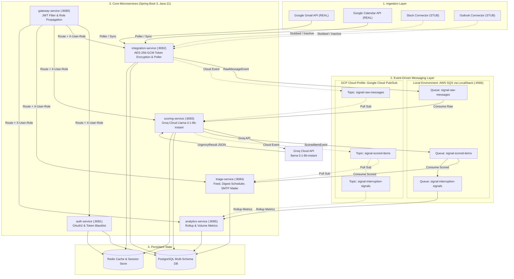

# ☕ Signal — Backend Services

<p align="left">
  
</p>

---

## 📖 Overview

**Signal Backend** is a multi-module microservice platform built on **Spring Boot 3**, **Java 21**, and **Docker**. It orchestrates real-time message polling from Google Workspace (Gmail, Calendar), applies intelligent AI urgency scoring via Groq (`llama-3.1-8b-instant`), and delivers targeted email digest notifications — all running inside a containerized, event-driven architecture.

---

## 🏛️ System Architecture



---

## 🔌 Real vs Stub Integrations

| Provider | Status | Implementation Details |
|---|---|---|
| **Google Gmail** | **REAL** | Polls Google Gmail REST API (`/gmail/v1/users/me/messages?q=is:unread`), parses RFC 822 headers, extracts snippets, and performs automatic OAuth2 refresh token rotation. |
| **Google Calendar** | **REAL** | Ingests calendar events via Google Calendar v3 API (`/calendar/v3/calendars/primary/events`) to detect upcoming meetings and context changes. |
| **Slack** | **STUB** | Stub connector structure retained for OAuth flow and future webhook ingestion. Mock random generator permanently disabled to ensure zero synthetic data. |
| **Microsoft Outlook** | **STUB** | Stub entity and endpoint structure preserved. Synthetic generator disabled; ready for Microsoft Graph API credentials. |

---

## 🔄 Dual Messaging: LocalStack SQS vs GCP Pub/Sub

Signal Backend supports two interchangeable messaging backends depending on the active Spring profile:

1. **Local Development Profile (`docker` / default `application.yml`)**:
   - **Engine**: **AWS SQS** running in **LocalStack** container at `http://localhost:4566`.
   - **Queues**: `signal-raw-messages`, `signal-scored-items`, `signal-interruption-signals`.
   - **Configuration**: Managed via `io.awspring.cloud:spring-cloud-aws-starter-sqs`.
2. **GCP Cloud Profile (`gcp` / `application-gcp.yml`)**:
   - **Engine**: **Google Cloud Pub/Sub** topics and pull subscriptions.
   - **Autoconfiguration**: AWS SQS autoconfiguration is explicitly excluded (`io.awspring.cloud.autoconfigure.sqs.SqsAutoConfiguration`).
   - **Topics**: `signal-raw-messages`, `signal-interruption-signals`, `signal-scored-items`.
3. **Architectural Abstraction**:
   - Service business logic interacts strictly through domain event publishers (`RawMessagePublisher`, `InterruptionSignalPublisher`, `ScoredItemPublisher`) and subscriber listeners. This decoupling allows running locally with zero AWS/GCP bills on LocalStack, while seamlessly deploying to GCP without modifying application code.

---

## 👨‍💻 What I Built (Akaash-S)

* **Enterprise Token Encryption at Rest (`AesGcmEncryptionConverter`)**:
  * Implemented AES-256-GCM authenticated encryption for OAuth refresh tokens stored in PostgreSQL.
  * Enforced strict 32-byte (256-bit) key validation supporting raw 32-byte UTF-8, 64-character hex, or 32-byte Base64 via `SIGNAL_ENCRYPTION_KEY`.
  * Designed explicit startup failure (`IllegalStateException`) if `SIGNAL_ENCRYPTION_KEY` is missing in production.
  * Utilizes dynamic 12-byte initialization vectors (`SecureRandom`) per encryption and 128-bit authentication tags to prevent replay and tampering.
  * Formatted output with explicit versioning prefix `v1:ENC:<base64-payload>`.
  * Built transparent **decrypt-with-fallback** allowing legacy plaintext tokens to continue working seamlessly, with automatic re-encryption to `v1:ENC:` on entity save.
  * Created `RefreshTokenMigrationService` to batch-migrate legacy rows on demand.
* **API Gateway Role & Identity Propagation (`JwtAuthFilter`)**:
  * Configured `JwtAuthFilter` in `gateway-service` to validate incoming JWTs.
  * Extracted `role` claim from JWT payload and forwarded downstream as `X-User-Role` alongside `X-User-Id` for role-based access control.
  * Added comprehensive tests covering allowed requests (with `ROLE_ADMIN` and `ROLE_MEMBER`), denied requests (missing or invalid Authorization headers), and public path bypasses.
* **Real Google Workspace Integration Poller**:
  * Built real Google Gmail API polling (`/gmail/v1/users/me/messages?q=is:unread`) with header parsing and message snippet extraction.
  * Built Google Calendar API polling (`/calendar/v3/calendars/primary/events`).
  * Automated Google OAuth2 token refresh with failure tracking (`EXPIRED` status updates).
  * Implemented randomized jitter (50ms–200ms) on pollers to eliminate thundering herd synchronization.
  * Completely purged synthetic mock generators.
* **AI Urgency Scoring with Groq Cloud**:
  * Migrated scoring engine to **Groq Cloud API** using `llama-3.1-8b-instant`.
  * Built structured system prompts, strict exception escalation, and Markdown fence stripping.
* **Test Suite Expansion**:
  * Expanded backend test suite to **36 automated unit tests** (100% passing across the reactor).

---

## 👥 Contribution Table

*Extracted directly from git repository history (`git shortlog -sn HEAD`):*

| Commits | Author | Primary Areas of Contribution |
|:---:|---|---|
| **48** | **Akaash-S** | Architecture, Gateway JWT & Role Filter, AES-256-GCM Token Encryption, Real Gmail/Calendar Pollers, Groq LLM Scorer, LocalStack/Docker Compose, Cloud Run Deployments. |
| **3** | **DhivyaSivakumar123** | Initial project scaffolding, base entity definitions, initial DTO models. |

---

## 🚀 Honest Deployment Status

*Verified via Google Cloud SDK (`gcloud run services list`):*

| Service | Target Platform | Live Cloud Run Endpoint | Health / Status |
|---|---|---|---|
| 🔀 **Gateway Service** | Google Cloud Run (`us-central1`) | `https://gateway-service-5omfrxib4q-uc.a.run.app` | **Live (`Ready: True`)** — Central entry point & JWT authentication filter. |
| 🔑 **Auth Service** | Google Cloud Run (`us-central1`) | `https://auth-service-5omfrxib4q-uc.a.run.app` | **Live (`Ready: True`)** — OAuth2 handling & JWT generation. |
| 📥 **Integration Service** | Google Cloud Run (`us-central1`) | `https://integration-service-5omfrxib4q-uc.a.run.app` | **Live (`Ready: True`)** — Real Gmail/Calendar polling & AES-256-GCM token crypto. |
| 🧠 **Scoring Service** | Google Cloud Run (`us-central1`) | `https://scoring-service-5omfrxib4q-uc.a.run.app` | **Live (`Ready: True`)** — Groq AI priority scoring engine. |
| 📋 **Triage Service** | Google Cloud Run (`us-central1`) | `https://triage-service-5omfrxib4q-uc.a.run.app` | **Live (`Ready: True`)** — Triage feed, preferences & digest dispatch. |
| 📈 **Analytics Service** | Google Cloud Run (`us-central1`) | `https://analytics-service-5omfrxib4q-uc.a.run.app` | **Live (`Ready: True`)** — Team rollup & interruption metrics. |

*Local & Infrastructure State:*
- **Local Dev Orchestration**: Fully runnable locally via Docker Compose (PostgreSQL with 5 schemas, Redis, LocalStack SQS).
- **Cloud IAM Security**: Downstream Cloud Run services are secured with Google Cloud IAM (`roles/run.invoker`) for internal microservice communication through Gateway Service.

---

## 🐳 Docker Compose Quickstart (Clean Clone)

Follow these steps to run the entire backend stack from a clean clone:

### 1. Clone Repository
```bash
git clone https://github.com/Akaash-S/signal_backend.git
cd signal_backend
```

### 2. Configure Environment File
Copy the example environment template:
```bash
cp .env.example .env
```
Ensure the following key variables are set in `.env`:
```properties
# AES-256 encryption key (exactly 32 bytes or 64 hex chars)
SIGNAL_ENCRYPTION_KEY=0123456789abcdef0123456789abcdef0123456789abcdef0123456789abcdef

# JWT Secret
SIGNAL_JWT_SECRET=super_secret_jwt_key_that_is_long_enough_for_hmac256_security

# AI Scoring Provider (Groq)
SIGNAL_SCORING_PROVIDER=groq
SIGNAL_SCORING_GROQ_API_KEY=gsk_your_groq_api_key_here

# Database credentials
SPRING_DATASOURCE_URL=jdbc:postgresql://postgres:5432/signal_db
SPRING_DATASOURCE_USERNAME=postgres
SPRING_DATASOURCE_PASSWORD=postgres
```

### 3. Build Service JARs
Using the Maven wrapper:
```bash
# On Linux/macOS:
./mvnw clean package -DskipTests

# On Windows (PowerShell):
$env:JAVA_HOME = "C:\Program Files\Java\jdk-21.0.10"; ./mvnw clean package -DskipTests
```

### 4. Start Containers
```bash
docker compose --env-file .env up -d --build
```

### 5. Verify Running Services
```bash
docker compose ps
```
All 6 microservices, PostgreSQL, Redis, and LocalStack will be healthy and accessible:
- **API Gateway**: `http://localhost:8080`
- **Auth Service**: `http://localhost:8081`
- **Integration Service**: `http://localhost:8082`
- **Scoring Service**: `http://localhost:8083`
- **Triage Service**: `http://localhost:8084`
- **Analytics Service**: `http://localhost:8085`
- **LocalStack**: `http://localhost:4566`
- **Redis**: `localhost:6379`

---

## 🧪 Automated Test Suite

Run all tests across the reactor:
```bash
./mvnw test
```

### Test Count Breakdown (Evidence from `./mvnw test` session):
| Module | Test Class | Passed | Failed | Errors | Skipped |
|---|---|:---:|:---:|:---:|:---:|
| `common-lib` | *(Shared library models)* | 0 | 0 | 0 | 0 |
| `gateway-service` | `JwtAuthFilterTest` | 7 | 0 | 0 | 0 |
| `auth-service` | `AuthControllerTest`, `AuthRedisLogicTest` | 5 | 0 | 0 | 0 |
| `integration-service` | `AesGcmEncryptionConverterTest`, `EmailPollerTokenRefreshTest`, `RefreshTokenMigrationServiceTest` | 16 | 0 | 0 | 0 |
| `scoring-service` | `GroqUrgencyScorerTest` | 8 | 0 | 0 | 0 |
| `triage-service` | *(Service consumers)* | 0 | 0 | 0 | 0 |
| `analytics-service` | *(Rollup aggregators)* | 0 | 0 | 0 | 0 |
| **Grand Total** | **All Modules** | **36** | **0** | **0** | **0** |

---

## 🔒 Security & Hygiene Audit

- **Tracked Files Check**: Verified that no `*.tfvars`, `*.tfstate`, or `.env*` files containing secrets are tracked in git (`.env.example` and `terraform.tfvars.example` are committed as sanitized templates).
- **Database Initialization**: `init-db.sql` only declares PostgreSQL schemas (`CREATE SCHEMA IF NOT EXISTS ...`); it contains zero user credentials, passwords, or sensitive seed data.
