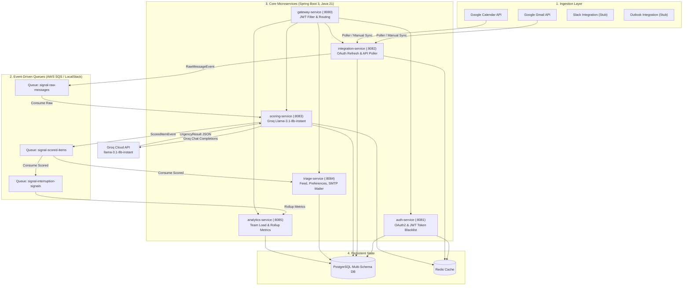

# ☕ Signal — Backend Services

<p align="left">
  
</p>

---

## 📖 Overview

**Signal Backend** is a multi-module microservice platform built on **Spring Boot 3**, **Java 21**, and **Docker**. It orchestrates real-time message polling from Slack, Gmail, Outlook and Calendar, applies intelligent scoring and prioritization, and delivers targeted email digest notifications — all running inside a fully containerized environment.

---

## 🏗️ Microservices

| Service | Port | Responsibility |
|---|---|---|
| 🔀 **Gateway Service** | `8080` | Reverse proxy, JWT auth filter, centralized security. |
| 🔑 **Auth Service** | `8081` | OAuth 2.0 login flow and JWT credential generation. |
| 📥 **Integration Service** | `8082` | Real-time polling connectors for Slack, Gmail, Outlook. |
| 🧠 **Scoring Service** | `8083` | AI priority ranking engine based on user preferences. |
| 📋 **Triage Service** | `8084` | Preferences, digest scheduling, SMTP delivery. |
| 📈 **Analytics Service** | `8085` | Team workspace volume and communication stats. |

---

## ✨ Features

- **📧 Real SMTP Email Digest** — Authenticated Gmail SMTP delivery with SSL trust config and native DB user email lookup.
- **⏰ IST-Aware Scheduler** — Cron-based digest dispatching that runs on Indian Standard Time (`Asia/Kolkata`) inside Docker containers.
- **🐳 Full Container Orchestration** — One-command `docker-compose` setup spinning up Postgres, Redis, and LocalStack (AWS SQS/S3 mock).
- **🔒 JWT Security** — Gateway-enforced token validation protecting all downstream services.

---

## 🛠️ Tech Stack

| Layer | Technology |
|---|---|
| Language | Java 21 (Virtual Threads) |
| Framework | Spring Boot 3, Spring Security |
| Database | PostgreSQL (Neon cloud + local Docker) |
| Messaging | AWS SQS (via LocalStack for local dev) |
| Cache | Redis |
| Email | JavaMailSender + Gmail SMTP |
| Container | Docker, Docker Compose |

---

## 🚀 Getting Started

### Prerequisites
- [Docker Desktop](https://www.docker.com/)
- [JDK 21](https://adoptium.net/)
- [Maven 3.8+](https://maven.apache.org/)

### Environment Setup
Create a `.env` file in the `backend/` directory:

```properties
# Gmail SMTP
SPRING_MAIL_HOST=smtp.gmail.com
SPRING_MAIL_PORT=587
SPRING_MAIL_USERNAME=yourmail@gmail.com
SPRING_MAIL_PASSWORD=your_16_char_app_password
```

### Build & Deploy
```bash
# Build all service JARs
.\mvnw.cmd clean package -DskipTests

# Start all containers
docker-compose --env-file .env up -d --build
```

### View Logs
```bash
docker logs -f triage-service
```

---

## 🏛️ System Architecture



---

## 👨‍💻 What I Built (Akaash-S)

* **Real Google Workspace Integration Pipeline**:
  * Implemented real Google Gmail API polling (`/gmail/v1/users/me/messages?q=is:unread`), RFC 822 email header extraction, and snippet extraction.
  * Implemented Google Calendar API polling (`/calendar/v3/calendars/primary/events`) to ingest events and scheduling changes.
  * Built automatic Google OAuth2 Refresh Token exchange with token expiration handling and `EXPIRED` status tracking.
  * Added randomized polling jitter (`50ms–200ms`) across all pollers to eliminate thundering herd synchronization.
  * Completely eliminated mock client generators from pollers, ensuring pure real-world message delivery.
* **LLM Scoring Engine Migration to Groq**:
  * Migrated the AI Scoring service provider from OpenAI to **Groq Cloud API** using `llama-3.1-8b-instant`.
  * Designed structured system prompts and robust Markdown fence sanitizers for clean JSON output (`NOW`, `TODAY`, `THIS_WEEK`, `FYI`).
  * Enforced strict exception escalation (`IllegalStateException`, `RuntimeException`) across scorers, replacing silent fallback defaults.
  * Added millisecond execution timing logs around Groq API calls for latency tracking.
* **Interactive Manual Sync**:
  * Implemented the `/api/integrations/sync` endpoint in `IntegrationController` to allow immediate, on-demand synchronization across connected providers.
* **Multi-Container Orchestration & Infrastructure**:
  * Configured multi-container Docker Compose environments with PostgreSQL schemas (`auth`, `integration`, `scoring`, `triage`, `analytics`), Redis, and LocalStack SQS queues.
  * Configured IST (`Asia/Kolkata`) scheduling and real Gmail SMTP delivery in containerized environments.
* **Quality Assurance**:
  * Added unit test suites for Groq JSON cleanup/parsing and Google OAuth token-refresh recovery.

---

## 🐳 Docker Compose Quick Start

### 1. Prerequisites
- Docker Engine & Docker Compose
- JDK 21 and Maven 3.8+ (for local builds)

### 2. Configure Environment
Copy `.env.example` to `.env` and configure your credentials:
```bash
cp .env.example .env
```
Key properties to configure in `.env`:
```properties
# Required for AI scoring
SIGNAL_SCORING_PROVIDER=groq
SIGNAL_SCORING_GROQ_API_KEY=gsk_your_groq_api_key

# Database (Local Docker Postgres or Neon Cloud)
SPRING_DATASOURCE_URL=jdbc:postgresql://postgres:5432/signal_db
SPRING_DATASOURCE_USERNAME=postgres
SPRING_DATASOURCE_PASSWORD=postgres

# Google OAuth2 (for Gmail & Calendar integrations)
SPRING_SECURITY_OAUTH2_CLIENT_REGISTRATION_GOOGLE_CLIENT_ID=your-google-client-id
SPRING_SECURITY_OAUTH2_CLIENT_REGISTRATION_GOOGLE_CLIENT_SECRET=your-google-client-secret
```

### 3. Build & Launch
```bash
# Package all microservices
mvn clean package -DskipTests

# Start all containers in background
docker compose --env-file .env up -d --build
```

### 4. Verify Services
Check container health:
```bash
docker compose ps
```
Services will be accessible on:
- **API Gateway**: `http://localhost:8080`
- **Auth Service**: `http://localhost:8081`
- **Integration Service**: `http://localhost:8082`
- **Scoring Service**: `http://localhost:8083`
- **Triage Service**: `http://localhost:8084`
- **Analytics Service**: `http://localhost:8085`
- **LocalStack SQS**: `http://localhost:4566`
- **Redis**: `localhost:6379`

